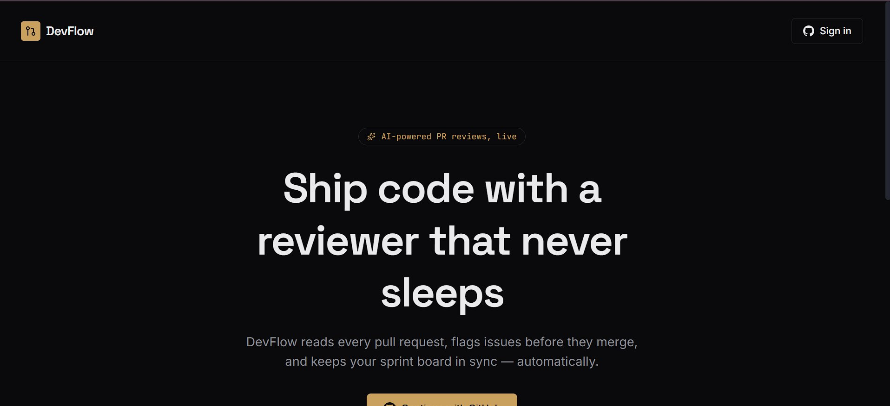
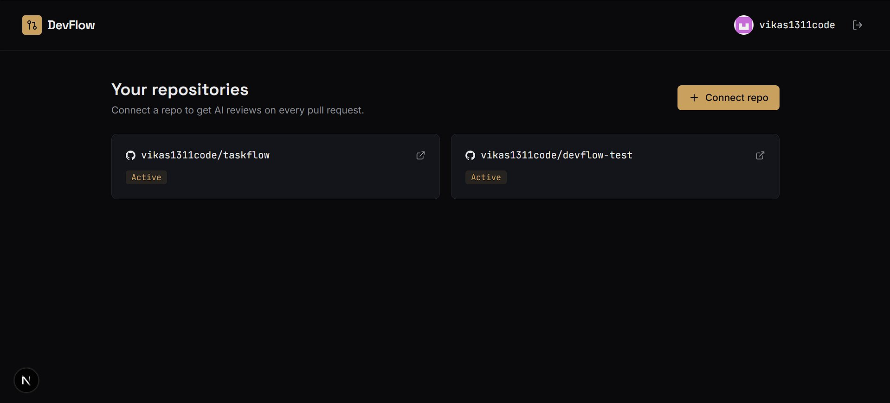
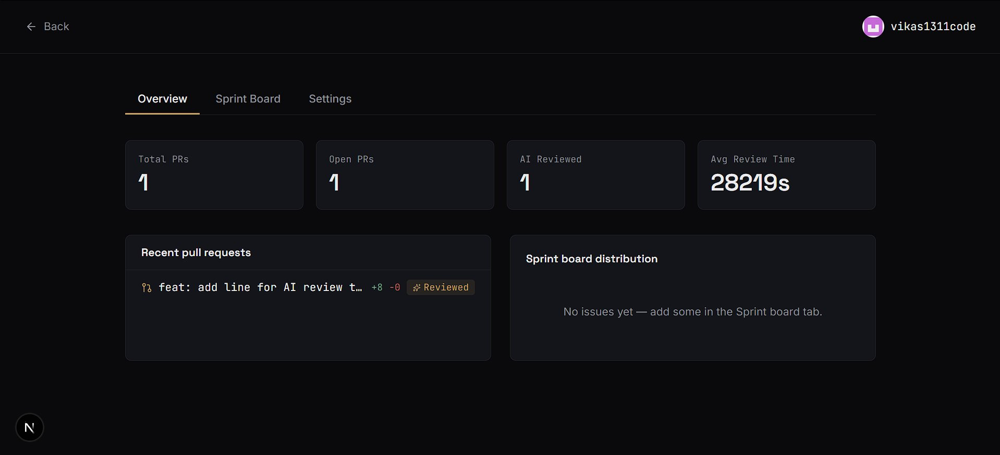
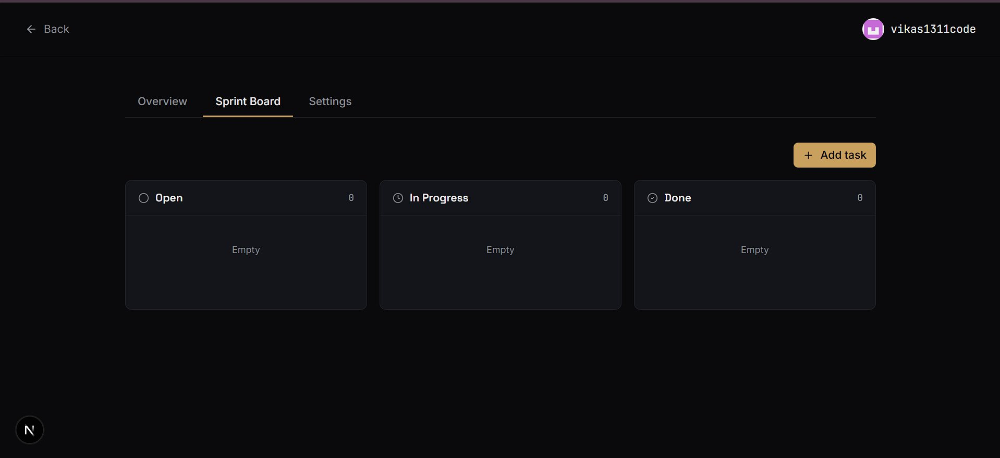
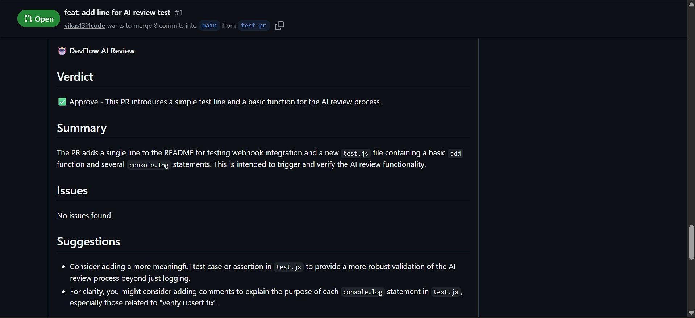
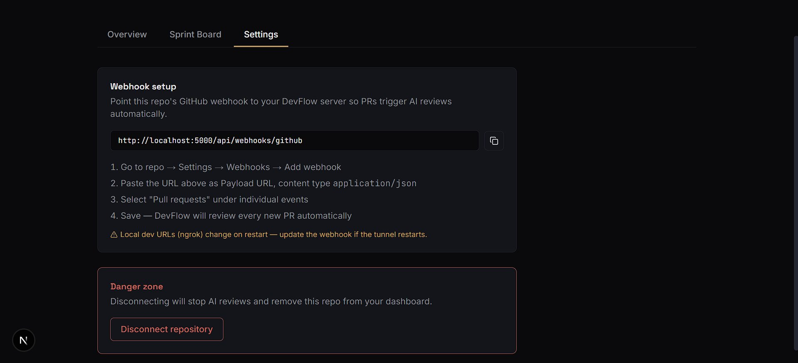

<div align="center">

# 🚀 DevFlow

### AI-powered pull request reviewer, sprint board & analytics for teams who ship fast.

[](https://demonflow.vercel.app)
[](https://demonflow.onrender.com/health)

[](https://nextjs.org)
[](https://expressjs.com)
[](https://postgresql.org)
[](https://ai.google.dev)
[](https://typescriptlang.org)
[](https://docker.com)

</div>

---

## 📖 About

DevFlow turns every pull request into a reviewed, scored, and tracked unit of work, automatically.

The moment a developer opens or updates a PR, DevFlow:

1. **Reads the diff** through the GitHub API
2. **Generates AI reviews from multiple personas**: a main reviewer, a security specialist, a performance analyst and a junior developer asking clarifying questions
3. **Calculates a Blast Radius risk score** (0-100) from diff size, files touched and historical file churn
4. **Auto-fixes critical security issues** by pushing a patch commit to the PR branch
5. **Posts everything as PR comments** and stores the data in PostgreSQL
6. **Shows it all on a live dashboard** with a sprint board and analytics

---

## ✨ Features

| Feature | Description |
|---|---|
| 🤖 **Multi-Persona AI Review** | Main verdict plus Security, Performance and Junior Dev reviews, each posted as a separate GitHub comment. |
| 🎯 **Blast Radius Score** | 0-100 risk score per PR. Frequently changed "hot files" are flagged automatically. |
| 🔧 **Auto-Fix Engine** | When the security review finds a critical issue, DevFlow generates a fix and commits it to the PR branch. |
| 👤 **Developer Profiles** | Tracks per-developer risk and change patterns across PRs. |
| 🔐 **GitHub OAuth + JWT** | Secure sign-in with access and refresh tokens and auth middleware. |
| ⚡ **Real-time Webhooks** | PR events are processed within seconds of being opened or updated. |
| 📋 **Sprint Board** | Simple Kanban (Open → In Progress → Done) per repository. |
| 📊 **Analytics Dashboard** | PR throughput, review coverage, risk trends and diff size charts. |
| 🛡️ **Hardened API** | Helmet, rate limiting, CORS allow-list and parameterized SQL queries. |

---

## 📸 Screenshots

<table>
<tr>
<td width="50%">

**Landing**


</td>
<td width="50%">

**Dashboard**


</td>
</tr>
<tr>
<td width="50%">

**Analytics Overview**


</td>
<td width="50%">

**Sprint Board**


</td>
</tr>
<tr>
<td width="50%">

**AI Review on GitHub**


</td>
<td width="50%">

**Webhook Settings**


</td>
</tr>
</table>

---

## 🧠 How it works

```
 Developer opens / updates a PR
              │
              ▼
   GitHub Webhook (pull_request)
              │
              ▼
   DevFlow API  (Express on Render)
              │
   ┌──────────┼───────────────┐
   ▼          ▼               ▼
 Fetch      Risk score     Gemini AI reviews
 PR diff    + file churn   (main / security /
 (GitHub    (PostgreSQL)    performance / junior)
  API)
              │
              ▼
   Post comments on the PR  ──►  Critical security issue?
              │                          │
              ▼                          ▼
   Save to PostgreSQL            Auto-fix commit to PR branch
              │
              ▼
   Next.js dashboard (Vercel)
```

---

## 🛠 Tech stack

| Layer | Technology |
|---|---|
| **Frontend** | Next.js (App Router), TypeScript, Tailwind CSS, Recharts, Lucide Icons |
| **Backend** | Node.js, Express.js, PostgreSQL, JWT, Helmet, express-rate-limit |
| **AI** | Google Gemini API |
| **Integrations** | GitHub OAuth, REST API, Webhooks, Contents API |
| **Hosting** | Vercel (frontend), Render (API), Neon (PostgreSQL) |

---

## 📁 Project structure

```
dev-flow/
├── backend/
│   └── src/
│       ├── config/         # DB connection, schema.sql
│       ├── controllers/    # auth, repos, webhooks, analytics
│       ├── middleware/     # JWT auth
│       ├── routes/
│       ├── services/       # github, aiReview, risk, autoFix, personality
│       └── index.js
├── frontend/
│   └── src/
│       ├── app/            # pages (landing, dashboard, auth)
│       └── lib/            # api client, auth context
├── docs/screenshots/
└── docker-compose.yml
```

---

## ⚙️ Environment variables

### Backend (`backend/.env`)

| Variable | Description |
|---|---|
| `PORT` | Server port (default `5000`; Render sets it automatically) |
| `DATABASE_URL` | PostgreSQL connection string |
| `JWT_SECRET` | Secret for access tokens |
| `JWT_REFRESH_SECRET` | Secret for refresh tokens (use a different value) |
| `GITHUB_CLIENT_ID` | GitHub OAuth App client ID |
| `GITHUB_CLIENT_SECRET` | GitHub OAuth App client secret |
| `GITHUB_PAT` | Fine-grained token used to read PRs and post comments |
| `GEMINI_API_KEY` | Google Gemini API key |
| `GEMINI_MODEL` | Optional. Defaults to `gemini-3.5-flash-lite` |
| `BACKEND_URL` | Public backend URL, no trailing slash, no `/api` |
| `FRONTEND_URL` | Public frontend URL, no trailing slash (used for CORS and redirects) |

Generate strong JWT secrets with:

```bash
node -e "console.log(require('crypto').randomBytes(48).toString('hex'))"
```

### Frontend (`frontend/.env.local`)

| Variable | Description |
|---|---|
| `NEXT_PUBLIC_API_URL` | Backend URL **including** `/api`, e.g. `https://your-api.onrender.com/api` |

---

## 💻 Running locally

### Prerequisites

- Node.js 20+
- PostgreSQL (local, Docker or Neon)
- [ngrok](https://ngrok.com) for receiving webhooks locally
- A GitHub OAuth App and a fine-grained personal access token
- A free Gemini API key from [aistudio.google.com/apikey](https://aistudio.google.com/apikey)

### 1. Database

```bash
psql "$DATABASE_URL" -f backend/src/config/schema.sql
```

### 2. Backend

```bash
cd backend
npm install
cp .env.example .env     # fill in the values
npm run dev
```

### 3. Frontend

```bash
cd frontend
npm install
cp .env.example .env.local
npm run dev
```

Open `http://localhost:3000`.

### 4. Webhook (local development)

```bash
ngrok http 5000
```

Use `https://<ngrok-url>/api/webhooks/github` as the webhook payload URL (see [Webhook setup](#4-github-webhook)).

For local OAuth, set the callback URL to `http://localhost:5000/api/auth/github/callback`.

---

## 🌐 Deployment guide

This setup uses **Neon** (database), **Render** (backend) and **Vercel** (frontend). All three have free tiers.

### 1. Database (Neon)

1. Create a project on [neon.tech](https://neon.tech).
2. Copy the connection string from **Connect**.
3. Open the **SQL Editor**, paste the contents of `backend/src/config/schema.sql` and run it.

### 2. Backend (Render)

1. **New → Web Service**, connect your GitHub repo.
2. Settings:
   - **Root Directory:** `backend`
   - **Build Command:** `npm install`
   - **Start Command:** `npm start`
3. Add all backend environment variables from the table above.
4. After deploy, open `https://<your-service>.onrender.com/health`. It should return `status: ok`.

> **Note:** Render's free tier sleeps after inactivity. The first request after a break can take 30-50 seconds.

### 3. Frontend (Vercel)

1. **Add New → Project**, import the same repo.
2. Set **Root Directory** to `frontend`.
3. Add the environment variable `NEXT_PUBLIC_API_URL=https://<your-service>.onrender.com/api`.
   - Set its type to **Config / Plain** (not Secret). Vercel rejects secrets for `NEXT_PUBLIC_` variables.
4. Deploy. If you change this variable later, **redeploy**, because it is baked in at build time.
5. Copy your Vercel URL into the backend's `FRONTEND_URL` on Render.

### 4. GitHub OAuth App

GitHub → **Settings → Developer settings → OAuth Apps → New OAuth App**

| Field | Value |
|---|---|
| Homepage URL | `https://<your-app>.vercel.app` |
| Authorization callback URL | `https://<your-service>.onrender.com/api/auth/github/callback` |

Put the generated Client ID and Client Secret into Render as `GITHUB_CLIENT_ID` and `GITHUB_CLIENT_SECRET`.

### 5. Personal access token

GitHub → **Settings → Developer settings → Personal access tokens → Fine-grained tokens**

- **Repository access:** select the repositories you want DevFlow to review
- **Repository permissions:**
  - Pull requests: **Read and write**
  - Issues: **Read and write** (PR comments use the Issues API)
  - Contents: **Read and write** (needed for auto-fix commits)

Save the token as `GITHUB_PAT`.

### 6. GitHub webhook

In each repository you want reviewed: **Settings → Webhooks → Add webhook**

| Field | Value |
|---|---|
| Payload URL | `https://<your-service>.onrender.com/api/webhooks/github` |
| Content type | `application/json` |
| Events | **Let me select individual events** → only **Pull requests** |

### 7. Connect a repo and test

1. Sign in with GitHub on your frontend.
2. Click **Connect repo** and enter `owner/repo`.
3. Open a pull request in that repository.
4. Within about a minute, DevFlow's review comments appear on the PR.

---

## 🩺 Troubleshooting

| Symptom | Likely cause |
|---|---|
| Login redirects back to the landing page | `FRONTEND_URL` has a trailing `/`, or CORS origin does not match your frontend URL |
| Login button goes to `localhost:5000` | `NEXT_PUBLIC_API_URL` not set, or frontend not redeployed after setting it |
| GitHub shows `redirect_uri_mismatch` | OAuth callback URL does not exactly match `BACKEND_URL` + `/api/auth/github/callback` |
| `relation "users" does not exist` | `schema.sql` was not run on the database |
| Webhook delivery times out | Render service was asleep. Open `/health`, then redeliver |
| No PR comments, log shows `404` from Gemini | The configured model is retired. Set `GEMINI_MODEL` to a currently available model |
| No PR comments, log shows `403 Resource not accessible by personal access token` | `GITHUB_PAT` is missing Pull requests / Issues write access, or the repo is not selected |
| Reviews only run on some PR events | Only `opened` and `synchronize` (new commits) trigger a review |

---

## 🗺 Roadmap

- [x] Multi-persona AI reviews
- [x] Blast Radius risk scoring with file churn tracking
- [x] Auto-Fix engine for critical security issues
- [ ] Webhook signature verification
- [ ] Silent token refresh on the frontend
- [ ] Slack / Discord notifications
- [ ] Per-organization analytics and velocity tracking
- [ ] GitHub App (instead of OAuth App) for org-wide installs

---

<div align="center">

Built with ☕ and a lot of pull requests.

</div>
